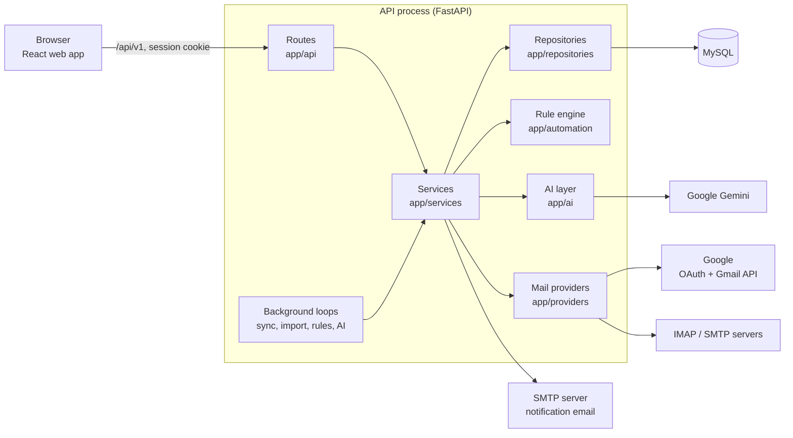
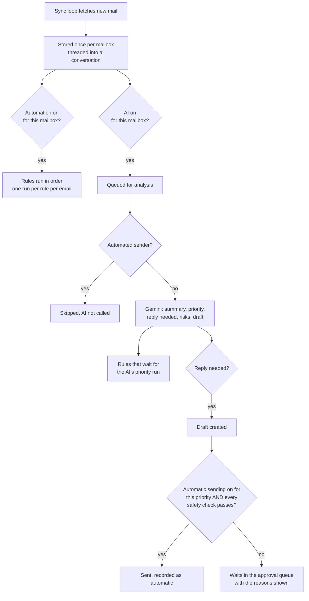

# Email Routing

A shared inbox for a team. Connect Gmail (and IMAP/SMTP) mailboxes into one workspace, then work the mail together: assign it, label it, reply to it, let rules sort it, and let AI summarise it and draft replies that a person approves.

This README covers what the app does, how it is built, how to install and run it, and how to use each feature.

## Contents

1. [What it does](#what-it-does)
2. [What is built and what is not](#what-is-built-and-what-is-not)
3. [Technology](#technology)
4. [Architecture](#architecture)
5. [How the main flows work](#how-the-main-flows-work)
6. [Install and run](#install-and-run)
7. [Configuration](#configuration)
8. [Setting up Gmail, AI and outgoing email](#setting-up-gmail-ai-and-outgoing-email)
9. [Using the app](#using-the-app)
10. [Roles and permissions](#roles-and-permissions)
11. [Commands, tests and checks](#commands-tests-and-checks)
12. [Project layout](#project-layout)
13. [API overview](#api-overview)
14. [Security](#security)
15. [Deployment notes](#deployment-notes)
16. [Troubleshooting](#troubleshooting)

## What it does

- **One inbox for many mailboxes.** Each connected mailbox syncs into a unified, Outlook-style mail screen.
- **Teamwork on mail.** Assign conversations, leave internal notes, mention teammates, set status and priority, use shared templates.
- **Rules.** "When a new email matches X, do Y", or "when an email has waited two days with no reply, do Y".
- **AI triage.** Each new email gets a summary, a Low/Medium/High priority, and a drafted reply when one is needed. Drafts wait in an approval queue.
- **Controlled automatic replies.** Optional, off by default, separately for Low and Medium priority, behind safety checks and a daily limit. High priority always needs a person.
- **Write with AI.** Wherever you write an email, type a short instruction and the AI writes or rewrites it.
- **Reminders, notifications and analytics.**

## What is built and what is not

| Area | State |
| --- | --- |
| Accounts, workspaces, roles, invitations, sessions, audit log | Built |
| Gmail by Google sign-in (OAuth 2.0 + Gmail API) | Built, used with real mailboxes |
| IMAP/SMTP mailboxes (app password) | Built, covered by tests, not exercised against a live server |
| Mail screen: read, send, reply, reply all, forward, attachments, search, labels, status, priority | Built |
| Per-mailbox access by role and by person | Built |
| Assignment, internal notes, mentions, notifications (in app and by email), contacts, templates, saved drafts | Built |
| Rules, run history, retries, timed rules, follow-up reminders | Built |
| AI summaries, priority, reply drafts, approval queue, automatic sending, Write with AI | Built (Google Gemini) |
| Analytics page | Built |
| Writing archive/delete/read state back to Gmail | Not built: these change only inside this app |
| Syncing folders other than the Inbox | Not built |
| Microsoft 365 sign-in | Not built (Outlook mailboxes can only connect over IMAP) |
| AI reading attachments | Not built |
| Webhooks, billing | Not built |
| Redis + Celery | Not built: background work runs inside the API process |

Screens for things that are not built say so. Nothing in the app shows sample data.

## Technology

| Layer | What |
| --- | --- |
| Web app | React 19, TypeScript, Vite, Tailwind CSS 4, wouter (routing), TanStack Query (data), Recharts (analytics charts) |
| API | Python, FastAPI, Pydantic |
| Data | MySQL 8, SQLAlchemy 2, Alembic migrations |
| Mail | Gmail API over HTTPS; IMAP/SMTP from the Python standard library |
| AI | Google Gemini over its REST API |
| Tests | pytest against a real MySQL test database |

## Architecture



### Layers

Every request goes through the same four layers, and each has one job:

| Layer | Folder | Job |
| --- | --- | --- |
| Routes | `backend/app/api` | Read the request, call a service, shape the response. No logic. |
| Services | `backend/app/services` | The rules of the product: who may do what, and what happens. They commit. |
| Repositories | `backend/app/repositories` | Database queries. |
| Models | `backend/app/models` | Tables. |

Two more pieces sit beside the services:

- `backend/app/providers`: one interface for a mailbox (`fetch`, `send`, `fetch_raw`), with a Gmail implementation and an IMAP/SMTP one.
- `backend/app/ai`: one interface for an AI model, the Gemini implementation, the triage logic (prompt, answer checks, safety checks) and the writer.

### Background work

There is no separate worker. When the API starts it starts four loops inside its own process:

| Loop | Every | Does |
| --- | --- | --- |
| Sync | 60 s | Fetches new mail for every connected mailbox |
| Import | continuously, paced | Brings in a newly connected mailbox's older mail, about 100 messages a minute to stay inside Google's limits |
| Automation tick | 30 s | Retries failed rule runs, runs timed rules, fires due reminders, sends notification emails |
| AI | 20 s | Analyses queued emails |

All pending work lives in database tables (`rule_runs`, `ai_analyses`, `ai_replies`, `reminders`, `notifications`), so nothing is lost when the process restarts. Each loop catches its own errors, so one failure does not stop the others. This design assumes **one API process**.

### Data model

All records belong to a workspace.

| Group | Tables |
| --- | --- |
| People | `users`, `workspaces`, `workspace_members`, `workspace_invitations`, `auth_sessions`, `password_reset_tokens`, `audit_events` |
| Mailboxes | `email_accounts`, `email_oauth_states`, `email_account_members`, `email_account_roles`, `folders` |
| Mail | `conversations`, `messages`, `message_recipients`, `attachments`, `labels`, `conversation_labels` |
| Teamwork | `drafts`, `notes`, `notifications`, `templates`, `reminders` |
| Rules | `rules`, `rule_runs`, `automation_settings` |
| AI | `ai_settings`, `ai_account_settings`, `ai_analyses`, `ai_replies` |

Attachments are not stored: the app keeps their names and sizes and fetches the file from the mailbox when someone downloads it.

Schema changes go through Alembic (`backend/migrations/versions`, currently `0001` to `0014`). Migrations only add; they never delete data.

### Web app

`frontend/src/App.tsx` decides what a visitor sees: sign-in screens, workspace setup, or the app. `frontend/src/lib/api.ts` is the only file that calls the backend. Pages live in `frontend/src/pages`. In development the Vite server forwards `/api` to the API, so the browser sees one origin.

## How the main flows work

### Connecting a Gmail mailbox

1. An owner or admin clicks **Sign in with Google**. The API creates a one-time state value (stored hashed, tied to the session, valid 10 minutes) and a PKCE verifier, and sends the browser to Google.
2. Google returns to `/api/v1/email-accounts/oauth/google/callback`. The API checks the state, exchanges the code for tokens, checks the granted permissions, and stores the tokens encrypted.
3. The first sync brings in recent mail; the import loop then brings in the rest of the inbox in the background.

### New mail arriving



Only mail that arrives after a mailbox's first sync counts as new. Mail that was already there, and imported history, never triggers rules or AI on its own; there are buttons to apply either to recent mail on request.

### Rules

A rule has a trigger, conditions and actions.

- **Triggers:** a new email arrives, or an email has waited with no reply for a set time.
- **Conditions** (all that are filled in must hold): mailbox, sender contains, recipient contains, subject contains, message contains, has attachments, the AI's priority.
- **Actions:** add a label, set priority, set status, assign to a person, share out in turn, flag, archive, notify a person.

Rules only change records inside this app; none can send email. A rule runs once per email, enforced by a unique key on `rule_runs`. A run that fails keeps none of its changes and is retried twice more.

### AI triage and replies

The email and its thread are given to the model as data between markers, with a fixed instruction never to follow anything written inside them. The answer must match a fixed shape; anything else is rejected and retried. The server then applies its own checks, which the model has no say in:

- text that tries to instruct the AI is flagged and the email is forced to High priority;
- every number and link in the drafted reply must appear in the thread or in the workspace's **business information**, otherwise the reply is marked unverified;
- a reply that makes a commitment ("I will…", "we'll…") is flagged.

A draft is sent only when a person who may send from that mailbox approves the exact text on screen (a fingerprint of the text is checked), or when automatic sending allows it. Either way it is claimed in one database step, so it cannot go out twice; it goes only to the original sender, in the original thread, and is refused if someone has already replied.

Automatic sending also requires: the priority's switch is on, no risk is flagged, the reply is short, the email is under a day old, the mailbox is connected, at most one automatic reply per conversation per day and three per person, and the daily limit is not reached. A failed automatic send goes to a person and is never retried on its own.

### Reminders and notifications

A reminder is a row with a due time. The automation tick fires due reminders as notifications; one set to "only if they have not replied" cancels itself if a reply came in. Notifications appear on the bell and, if SMTP is configured and the person has not switched it off, are also emailed once.

## Install and run

### Requirements

- Node.js 22.9 or newer, and pnpm
- Python 3.12 or newer
- MySQL 8

### Steps

```bash
git clone https://github.com/smartmithilesh/mail-automation.git
cd mail-automation

cp .env.example .env     # on Windows: copy .env.example .env
pnpm install
pnpm setup               # Python environment, local MySQL, database tables
pnpm dev                 # database, API and web app together
```

- Web app: http://localhost:5173
- API: http://localhost:5000 (interactive docs at `/api/docs`, health check at `/api/healthz`)

Open the web app, sign up, and create a workspace. The first person in a workspace is its owner.

### The database

`pnpm setup` and `pnpm dev` start a MySQL server that keeps its data in `./local-mysql` and listens only on `127.0.0.1:3308`. They look for the MySQL programs in `MYSQL_HOME` (set it in `.env` to the folder that contains `bin/mysqld`), then `./local-mysql/server`, then your `PATH`.

To use a MySQL server you already run, set `DATABASE_URL` in `.env` instead and create the database named in it.

The app works with only this much. Gmail, AI and email notifications each need the extra setup below, and their screens say "not set up" until it is done.

## Configuration

All settings live in `.env` in the repository root. Variables set in your shell win over the file. Never commit `.env`.

| Variable | Default | Purpose |
| --- | --- | --- |
| `APP_ENV` | `development` | Anything other than `development`, `dev`, `local` or `test` is treated as production |
| `APP_URL` | `http://localhost:5173` | Address of the web app. Used in email links and for the same-origin check |
| `PORT` | `5000` | Port the API listens on |
| `WEB_PORT` | `5173` | Port of the web dev server |
| `DATABASE_URL` | `mysql+pymysql://root@127.0.0.1:3308/email_management` | MySQL connection |
| `MYSQL_HOME` | empty | Folder of the MySQL server used by `pnpm db:start` |
| `GOOGLE_CLIENT_ID`, `GOOGLE_CLIENT_SECRET` | empty | Google app for Gmail sign-in |
| `GEMINI_API_KEY` | empty | Turns AI on. `AI_MODEL` is optional (default `gemini-3.5-flash-lite`) |
| `SMTP_HOST`, `SMTP_PORT`, `SMTP_USERNAME`, `SMTP_PASSWORD`, `SMTP_FROM` | empty | Outgoing email for password reset and notification emails |
| `ENCRYPTION_KEY` | empty | Long random secret that encrypts stored mailbox passwords and tokens. Required in production |
| `LOG_LEVEL` | `info` | API log level |
| `BASE_PATH` | `/` | Base path the web app is served from |

In production the API refuses to start unless `ENCRYPTION_KEY` is set, `APP_URL` starts with `https://`, and `DATABASE_URL` is not the local passwordless root login.

## Setting up Gmail, AI and outgoing email

### Gmail by Google sign-in

Gmail mailboxes connect through a Google app that you own. One-time setup:

1. In [Google Cloud Console](https://console.cloud.google.com/), create a project.
2. **APIs & Services > Library**: enable the **Gmail API**.
3. **APIs & Services > OAuth consent screen**: choose **External**, fill in the app name and your email, and add the scopes `gmail.modify` and `gmail.send`. While the app is in **Testing**, add every Gmail address you want to connect under **Test users**.
4. **APIs & Services > Credentials > Create credentials > OAuth client ID**: type **Web application**. Under **Authorized redirect URIs** add `http://localhost:5173/api/v1/email-accounts/oauth/google/callback` (replace the first part with your `APP_URL` when deployed).
5. Put the client ID and secret in `.env` as `GOOGLE_CLIENT_ID` and `GOOGLE_CLIENT_SECRET`, then restart `pnpm dev`.
6. In the app: **Email accounts > Add account > Google / Gmail > Sign in with Google**. Repeat for each mailbox.

Good to know:

- While the Google app is in **Testing**, Google ends each connection after 7 days. The mailbox then shows **Needs reconnecting**; click **Reconnect**.
- Offering Gmail sign-in to the public needs Google's verification, because reading and sending mail are restricted permissions.

### AI (Google Gemini)

1. Get a key at https://aistudio.google.com/apikey.
2. Add `GEMINI_API_KEY=your-key` to `.env` and restart.
3. In the app, an owner or admin opens **Settings > AI controls**, switches on **AI assistance**, and fills in **Business information**.

### Outgoing email (password reset and notification emails)

Any SMTP server works. With Gmail:

```
SMTP_HOST=smtp.gmail.com
SMTP_PORT=587
SMTP_USERNAME=you@gmail.com
SMTP_PASSWORD=a 16-character Google app password
SMTP_FROM=you@gmail.com
```

Create the app password at https://myaccount.google.com/apppasswords (2-Step Verification must be on). Restart after changing `.env`.

## Using the app

### Mail

| To do this | Do this |
| --- | --- |
| Read mail | **Unified inbox**. Folders on the left, list in the middle, the conversation on the right. Pick one mailbox or all. |
| Write | **New mail**. Choose the mailbox to send from, add recipients, attach files (18 MB in total). |
| Answer | **Reply**, **Reply all** or **Forward** in the command bar. |
| Find | The search box matches sender, subject and message text. The filter next to it narrows to unread, flagged, with attachments, assigned to me, a status or a priority. |
| Organise | **Labels** menu to label, **Status** menu for Open / Pending / Closed and for priority, **Flag**, **Archive**, **Delete**. |
| Fetch now | **Sync**. Mail is also fetched every minute. |
| Save for later | A message you start is saved as a draft as you type and listed under **Drafts**. |

Pictures in an email are not loaded until you click **Show pictures**, and scripts in an email never run.

### Working as a team

- **Assign:** the **Assign** menu gives a conversation to a teammate, who is notified. **Unassigned** lists what nobody owns.
- **Notes:** under each conversation, **Internal notes** are seen only by the team. Type `@` and a name to notify someone.
- **Templates:** create shared replies under **Templates**, then insert them from the **Templates** button in the composer. `{{recipient_name}}` and `{{my_name}}` are filled in.
- **Contacts:** everyone the team has received mail from or written to, gathered automatically.
- **Notifications:** the bell, and the **Notifications** page. To get them by email too, see **Settings > Profile > Email me my notifications**.

### Mailboxes and access

**Email accounts** lists connected mailboxes. For each one, **Access** sets who may use it: everyone in the workspace, or only chosen roles and people, each with "can read" or "can read and send". Owners and admins can always use every mailbox.

### Rules

1. **Automation > Rules > New rule** (or add the ready-made ones under **Suggested rules**).
2. Choose when it runs, fill in the conditions that matter, and add one or more actions.
3. **Try it on recent mail** shows what would match and changes nothing.
4. Switch automation on under **Settings > Automation**. It is off until someone turns it on, and each mailbox and each rule has its own switch.

Rules run top to bottom; when two set the same thing, the lower one wins. **Run on mail you already have** applies the rules to the latest emails in each mailbox on request. **What the rules did** lists every run.

### AI

| Where | What you get |
| --- | --- |
| A conversation | An **AI summary** box: summary, priority, whether a reply is needed, risks. **Analyse with AI** for mail that has not been analysed. |
| **AI overview** | The **approval queue** (Approve & send, Edit, Reject), the list of what the AI did, and **Analyse mail you already have**. |
| **Settings > AI controls** | The main switch, a switch per mailbox, automatic sending for Low and for Medium, the daily limit, the **Emergency stop**, and the business information. |
| The composer, a draft being edited, a template | **Write with AI**: type an instruction, press Enter. **Rewrite** changes what is there; **Undo** brings back the text from before. |

The business information is the only source of facts the AI may state besides the email thread. If a reply needs a fact that is not there, the draft says a teammate will confirm instead of guessing.

### Reminders

Open a conversation and choose **Remind me…**. Tick "only if they have not replied" to have it cancel itself when an answer arrives. **Automation > Scheduled actions** lists your reminders and the timed rules.

### Analytics

**Analytics** shows mail received and sent per day, the typical time to reply, rule runs, what the AI did, top senders, mailboxes, and workload per person, for the last 7, 30 or 90 days. Each chart can be shown as a table.

### Settings

Profile (name, look, email notifications), workspace details, security (password, where you are signed in), AI controls, automation, usage, and the audit log. The look can be Light, Custom (the glass design) or Dark.

## Roles and permissions

| | Owner | Admin | Manager | Agent | Viewer |
| --- | --- | --- | --- | --- | --- |
| Read mail in mailboxes they may use | Yes | Yes | Yes | Yes | Yes |
| Send, reply, label, assign, add notes | Yes | Yes | Yes | Yes | No |
| Approve or reject AI drafts (with "send" on that mailbox) | Yes | Yes | Yes | Yes | No |
| Create and edit rules and templates | Yes | Yes | Yes | No | No |
| Connect mailboxes, set mailbox access | Yes | Yes | No | No | No |
| Invite people, change roles, read the audit log | Yes | Yes | No | No | No |
| AI settings, automation switch, automatic sending | Yes | Yes | No | No | No |
| Make someone an owner, change or remove an owner | Yes | No | No | No | No |

Someone who cannot open every mailbox can only make rules for the mailboxes they can open, and sees only those rules.

## Commands, tests and checks

| Command | What it does |
| --- | --- |
| `pnpm dev` | Start MySQL if needed, apply migrations, run the API and the web app |
| `pnpm dev:api` / `pnpm dev:web` | Run only one of them |
| `pnpm db:start` / `pnpm db:stop` / `pnpm db:status` | Control the local MySQL |
| `pnpm db:migrate` | Apply database migrations |
| `pnpm test` | Backend tests, against the `email_management_test` database |
| `pnpm typecheck` | Typecheck the web app (also fails on unused code) |
| `pnpm build` | Typecheck and build the web app into `frontend/dist/public` |
| `python -m ruff check app tests` (in `backend/`, with its virtual environment) | Lint the backend |

Tests never use the development database, real Google, real Gemini or a real SMTP server: each has a stand-in. `backend/tests/test_security.py` holds the regression tests from the security review.

New migration: `cd backend`, then `.venv/Scripts/python -m alembic revision -m "what changed"` (`.venv/bin/python` on macOS and Linux).

## Project layout

| Path | Contents |
| --- | --- |
| `frontend/src/App.tsx` | Routing and the sign-in gate |
| `frontend/src/pages` | One file per area: `mail`, `accounts`, `automation`, `ai`, `analytics`, `reminders`, `collab`, `team`, `settings`, `dashboard`, `auth` |
| `frontend/src/components` | App shell, shared controls, brand mark |
| `frontend/src/lib/api.ts` | The one place the web app calls the backend |
| `frontend/src/*.css` | `index.css` (base and the glass look), `mail.css` (mail, rules, AI, analytics), `themes.css` (Light and Dark) |
| `backend/app/api` | HTTP routes |
| `backend/app/services` | Business logic |
| `backend/app/repositories` | Database queries |
| `backend/app/models` | Tables |
| `backend/app/providers` | Gmail and IMAP/SMTP |
| `backend/app/ai` | AI provider interface, Gemini, triage, writer |
| `backend/app/automation` | Rule conditions, actions, engine, scheduler |
| `backend/app/core` | Settings, database, security, errors, rate limiting |
| `backend/app/main.py` | App factory, middleware, background loops |
| `backend/migrations` | Alembic migrations |
| `backend/tests` | Backend tests |
| `scripts/tasks.mjs` | The tasks behind the `pnpm` commands |
| `docs/` | Product requirements, architecture, design, rules for contributors, task list, project notes, and the original proposal |

## API overview

Routes live under `/api/v1`. A successful response is `{"data": ...}`; a failure is `{"error": {"code", "message", "details"}}`. The session is a cookie, so requests that change something are only accepted from `APP_URL`. In development the full, interactive list is at http://localhost:5000/api/docs.

| Prefix | Covers |
| --- | --- |
| `/auth` | Register, login, logout, current user, password change and reset, sessions, accepting invitations |
| `/workspaces`, `/workspace` | Create and switch workspace, settings, members, invitations, audit log |
| `/email-accounts` | Connect (Google or IMAP/SMTP), list, sync, access, disconnect |
| `/conversations`, `/messages/send`, `/attachments`, `/labels` | Mail: list, read, update, batch, send, download, labels |
| `/drafts`, `/notes`, `/notifications`, `/contacts`, `/templates` | Teamwork |
| `/automation` | Rules, test, order, runs, settings, run on recent mail, summary |
| `/ai` | Status, settings, activity, analysis, approval queue, write |
| `/reminders`, `/analytics` | Reminders and the analytics report |

## Security

- **Sign-in:** passwords hashed with Argon2; sessions are random tokens stored hashed, in an HttpOnly, SameSite cookie (Secure in production). Login is rate limited per address and per location.
- **Tenancy:** every lookup is scoped to the caller's workspace, and mail is further scoped to the mailboxes the caller may use.
- **Secrets:** mailbox passwords and Google tokens are encrypted in the database. API keys stay on the server and are never returned or logged.
- **Cross-site requests:** changes are refused unless they come from the app's own address.
- **Headers:** every response tells the browser not to guess file types, not to frame the app, and not to pass on addresses; production adds HSTS and a content security policy.
- **Email content:** shown in a sandboxed frame; scripts never run and remote pictures are off until asked for.
- **Connecting a mailbox:** only mail ports, only encrypted connections, and server names that resolve to private network addresses are refused.
- **AI:** email text is treated as data, model output is checked against a fixed shape, and nothing the model says can trigger an action other than storing a draft.

## Deployment notes

The repository has a development setup only. To deploy it you still need:

1. A way to run the API in production (for example `uvicorn app.main:app` behind a reverse proxy with HTTPS) and to serve the built web app from `frontend/dist/public` on the same origin, with `/api` forwarded to the API.
2. A MySQL database with its own user and password.
3. `APP_ENV=production`, an `https://` `APP_URL`, and an `ENCRYPTION_KEY`. Set the key once and keep it: changing it makes stored mailbox connections unreadable.
4. The production redirect address registered in the Google app, and Google's verification if people outside your test list will connect mailboxes.
5. **One API process.** Background loops and rate limits live in that process. Running several would duplicate the loops; moving them to a queue (Redis + Celery) is the planned next step.
6. The reverse proxy configured so the API sees the real client address, or rate limits will treat every visitor as one.

## Troubleshooting

| Symptom | Cause and fix |
| --- | --- |
| Sign-in says "Something went wrong on our side" | The database is not running. Run `pnpm db:status`, then `pnpm db:start`. |
| `pnpm setup` cannot start MySQL | Set `MYSQL_HOME` in `.env` to your MySQL folder, or point `DATABASE_URL` at a server you already run. |
| "Connecting with Google isn't set up" | `GOOGLE_CLIENT_ID` and `GOOGLE_CLIENT_SECRET` are missing, or the API was not restarted after adding them. |
| Google shows `redirect_uri_mismatch` | The redirect address in the Google app must be exactly `{APP_URL}/api/v1/email-accounts/oauth/google/callback`. |
| A mailbox shows "Needs reconnecting" | Google ended the connection (after 7 days while the Google app is in Testing). Click **Reconnect**. |
| A new mailbox shows only some mail | The rest is still importing in the background. The Overview shows progress. |
| "AI is not set up yet" | `GEMINI_API_KEY` is missing or the API was not restarted. |
| Rules or AI do nothing | They are off until switched on (**Settings > Automation**, **Settings > AI controls**), and they act only on mail that arrives afterwards. |
| No notification emails or "Forgot password" unavailable | The `SMTP_*` settings are missing. |
| A change in `.env` has no effect | Restart `pnpm dev`: settings are read once at start. |
